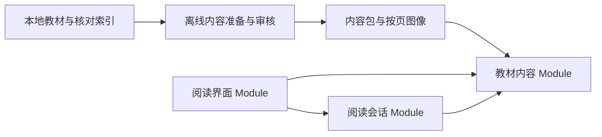

# 课本解读 · 系统架构设计

状态：保留 2026-10-23 的架构提案，另记录当前具体教材与第一章补充的实现。依据 [SPEC.md](SPEC.md) 的 S1–S3、C1–C6、R1–R7；领域术语见 [GLOSSARY.md](../GLOSSARY.md)。

当前实现使用人教版七年级上册全部 202 个 PDF 页面，支持上下连续滚动、可收起的左侧导航及页码输入。第一章已接入 12 条补充和 16 个原图定位，覆盖 PDF 第 8–30 页的逐页取舍记录。九年级教材运行资源与配方法解读已移除。以下先记录当前实现，再保留通用内容与会话 Module 的目标设计；目标 Interface 不代表已经实现的 API。

## 当前实现

| 文件 | Interface 与责任 |
| --- | --- |
| `scripts/prepare-textbook.mjs` | 校验源 PDF、索引及全部 202 张 PNG 的哈希；复用页图生成 WebP、缩略图和来源记录，输出 `book.json`，成功后移除旧九年级运行资源 |
| `src/textbook/book.json`、`catalog.ts` | 保存书名、源文件身份、页序和真实图像尺寸；导出 `pages`、`pageCount` 与 `getPage`，拒绝非整数或越界页序 |
| `src/reader/session.ts` | 纯几何函数 `readingPage` 与 `restoredScroll`，从页面位置计算当前页，并在宽度改变后恢复页内阅读比例 |
| `content/grade-7-volume-1/chapter-1.json`、`locations.json` | 分别维护补充正文、学习作用与逐页取舍，以及页序、印刷页码、索引锚点、原图哈希、归一化区域与标记坐标 |
| `src/textbook/supplements.ts` | 直接加载具体教材的两份 JSON，检查 PDF 身份一致，提供位置、补充及按页查询；不是通用内容编译器 |
| `src/reader/Reader.tsx` | 渲染全书与原位标记，持有预览、解读、关联返回栈和跳转状态；处理图像解码、区域定位、滚动与焦点恢复 |
| `src/reader/Supplement.tsx` | 呈现预览、补充正文及带阅读目的的关联入口；预览避让视口，正文面板按内容切换滚动位置 |

页面预留真实宽高比。滚动时按阅读区上方的参考线确定当前页，到底时选中末页。侧栏展开、收起或窗口缩放后，按当前页及页内比例恢复滚动位置。显式跳页先解码目标图像，成功后跳转；失败保留原位置，新的滚动或跳转使旧请求失效。

桌面侧栏可收起；收起后页码控件移入工具栏。窄屏使用浮动侧栏，跳页后关闭。💡 使用 `locations.json` 的 `marker` 坐标随原图缩放，关联目标使用 `region` 定位和高亮。没有补充的页不显示空解读栏。

悬浮或聚焦标记可预览，点击标记打开正文，预览内仅显示灰色操作提示；桌面使用右栏，窄屏使用下方面板。关联先解码目标页图，成功后记录来源并切换；失败保留来源。当前选中的关联目标不再显示为跳转入口，处理函数也拒绝再次跳到该目标，防止重复写入返回栈；返回后恢复来源的关联入口。返回栈在内存中保存来源页内比例、已选位置、解读、面板滚动和焦点。关闭抽屉会清除回顾位置与返回栈；页码、缩略图和上下页导航在成功后清空回顾历史，失败则保留原上下文。关闭时仅在来源灯泡可见的情况下把焦点还给它，否则聚焦当前教材页，避免键盘跳回远处。待加载时滚动或发起新导航会使旧请求失效；刷新后的恢复尚未实现。

第一章的 23 页均有取舍记录，12 条补充与 16 个位置通过 skill 选材、AI 辅助编写及原页复核产生。测试核对来源身份、索引锚点、页码、坐标范围和关联引用；它们不能代替数学及教学审核。运行时的会话状态仍由 Reader 管理，`session.ts` 仅负责几何计算。

## 1. 当前阅读布局与扩展方向

采用一个浏览器应用，配合离线准备、核对和审核的内容包。沿用现有技术栈；首版无需后端、数据库或在线生成解读。内容先审核，阅读时只加载已交付的内容。

```text
┌───────────────────────────────────────────────────────┐
│ 教材名称                                             │
├───────────┬──────────────────────┬────────────────────┤
│ 页码输入  │                      │ 返回 · 补充解读    │
│ 当前/总数 │      教材原页        │                    │
│           │                      │ 为什么 / 何时适用  │
│ 页缩略图  │ 对应段落、步骤 💡   │                    │
│           │              → 气泡 │ 知识关联与查看目的 │
│           │            点击灯泡 │ → 查看教材位置     │
└───────────┴──────────────────────┴────────────────────┘
```

- 保留浅色、无外框和无常驻说明的 💡。悬浮时预览，优先放在页外，空间不足时在底部显示；预览内以灰色提示“点击灯泡展开解读”，点击灯泡打开右栏。返回入口位于抽屉内，关联到仅含原文的目标时保留来源解读与返回入口。
- 原页、标记和气泡分层。右栏承载解释增量，不重复建立“课本已有”区域。
- 全书页面均可访问，无解读页仍正常阅读。左侧页码框展示文件页序与总数，可输入回车跳转；越界输入保留当前位置。版本信息保留在来源记录，不出现在界面。
- 右栏按内容组织段落，不强制每条解读都有“为什么 / 什么时候”等固定字段。当前每条补充有短预览，也可直接点击标记展开。
- 保留已确认的全书连续滚动与可收起导航。页面与标记共用缩放坐标，气泡在独立浮层定位并避让视口。
- 当前窄屏采用浮动导航、连续阅读和下方解读面板；键盘可聚焦 💡、展开和关闭。不同宽度下的定位与焦点仍需随完整阅读路径检查。

连续阅读和可收起导航按 R7 执行；以下解读状态策略属于目标设计建议，不改写 SPEC.md 中的确认状态。

## 2. 目标设计：三个 Module，各自隐藏一类复杂度



图中箭头表示素材流或调用依赖。运行时调用单向：界面依赖会话和教材内容，会话依赖教材内容；后二者不依赖 React、DOM 或网络。

| Module | Interface：调用方需要知道什么 | Implementation：内部负责什么 |
| --- | --- | --- |
| 教材内容 `catalog.ts` | 编译并校验内容包；解析教材位置，返回只读阅读内容或明确的缺失原因 | 版本与文件身份、页码映射、位置和解读索引、来源记录、关联目标解析 |
| 阅读会话 `session.ts` | 给定状态和动作，返回新状态；状态包含当前阅读现场、待完成跳转和返回上下文 | 选择解读、跳转事务、返回历史、失败保留来源、过期请求处理 |
| 阅读界面 `Reader.tsx` | `<Reader catalog={catalog} initialLocation={location} />`；合法的 catalog 由内容 Module 提供，初始位置无效时显示可恢复入口 | 原页加载、缩放与标记对齐、气泡、右栏、键盘焦点、滚动恢复、加载与失败反馈 |

这里的 Interface 包含数据约束、失败行为和使用顺序，不只指 TypeScript 类型。`main.tsx` 负责加载内容包和挂载 Reader，不加入新的业务层。

### 为什么这样拆

- **Depth**：页面只提交“打开解读 / 查阅关联 / 返回”，无需学习页码换算与历史维护细节。
- **Locality**：换一份教材文件时集中核对内容包；改变返回策略时只改会话；调整布局时只改界面。
- **Leverage**：气泡、右栏和导航共用同一份位置解析及会话规则，测试也通过相同 Interface 验证。
- 删除 `catalog`，版本、页码和关联解析会散入每个入口；删除 `session`，跳转和返回规则会散入每个按钮。这两个 Module 承担真实复杂度。
- 气泡、工具栏和右栏初期只是 Reader 的内部呈现函数。无需每个可见区域都建立一个独立 Module。

Module 的 Interface 位于其文件导出位置，即调用的 seam。首版直接使用具体实现，不为只有一种实现的图像加载、存储或内容读取建立可替换 Adapter 层。将来实际需要第二种实现时，再提取相应 seam。

## 3. 目标内容模型与定位

当前第一章采用静态 JSON 和段落字符串，位置使用单个归一化矩形及独立的标记坐标；内容不执行 HTML，也未增加公式排版依赖。下面是可扩展的目标模型；多区域、跨版本引用和通用编译 API 尚未实现，只有实际内容需要时再扩展。

| 记录 | 最少信息与约束 |
| --- | --- |
| 教材 | 稳定的版本 ID、书名、已核实版本信息、源 PDF 哈希、内容包修订号；未知信息明确保留未知 |
| 页面 | 版本内页面 ID、从 1 开始的文件页序、印刷页码及核对状态、页图路径、图像尺寸与哈希 |
| 教材位置 | 版本内位置 ID、页面 ID、可核对的位置标签、一个或多个原页区域；区域使用相对完整页图的归一化矩形 |
| 解读 | 解读 ID、教材位置 ID、标题、可选预览、正文块、解释增量说明、来源性质与来源引用、审核记录 |
| 知识关联 | 关联 ID、来源位置 ID、目标位置引用、关系说明、查看目的；未核实的候选出处与可跳转目标分别表达 |

页面 ID 和位置 ID 均在教材版本内唯一。跨记录引用使用完整的“版本 ID + 位置 ID”，不能只用“第8页”。位置标签可以是段落、题号或步骤；页面本身也可作为位置，但不能将其误称为已定位到具体步骤。

印刷页码是展示与核对信息，允许空值，也允许不同页码序列出现相同标签；它不是查找主键。文件页序只在对应源 PDF 内有效。源文件改变后，原有页序和区域必须重新核对，不能凭同名文件沿用。

归一化区域使用 `[0, 1]` 范围，以完整、已确定方向的页图左上角为原点。标记锚定该区域，气泡相对实际显示区域定位。重采样只改变分辨率时可以继续使用；裁边、旋转或换版时必须重新校准。单个位置可有多个区域；跨页题目以多个位置表达，再用解读或关联连接。

一处位置可以有多条解读；存在知识关联不要求目标必须另有解读。习题引导采用相同的解读模型，其审核遵循 C5，不另建题库或答题流程。

### 教材内容 Interface 示意

以下仅表达调用形状，不是已经定义的源代码类型：

```ts
compileCatalog(raw: unknown): CatalogResult
catalog.resolve(location: LocationRef): LocationResult
```

- `compileCatalog` 同步校验结构、唯一性、引用、页序、区域范围和审核记录，并建立索引。成功返回不可变 catalog；失败返回含记录 ID 的问题列表，不交付半有效 catalog。
- `resolve` 返回对应页图描述、展示页码、已选位置、本页可见标记、解读及已解析关联；失败区分版本缺失、位置缺失和来源未核实。不进行网络请求，也不猜测相近目标。
- 当前内容包内声明为可用的目标引用错误，编译失败；明确未包含的外部教材目标可返回不可用原因。未知出处不生成精确页码链接。
- 首版一次加载所选内容包的文字和索引，校验和建立索引的工作量随记录数线性增长；位置查找使用内存映射，查询结果大小取决于该页内容。页图独立按需加载，不把整本图像嵌入 JavaScript。

## 4. 阅读会话：来源在目标成功前保持不变

当前关联跳转与返回逻辑位于 `Reader.tsx`，`session.ts` 仅提供滚动几何计算。以下纯状态转换是后续可选重构方向，并非当前导出 API：

```ts
transition(state: ReadingState, action: ReadingAction, catalog: Catalog): ReadingState
```

`ReadingState` 包含当前教材位置、选中的解读与右栏状态、返回上下文，以及可选的待完成跳转和反馈。`ReadingAction` 只表达阅读意图和加载结果，不暴露气泡定时器或 DOM 节点。状态由会话唯一维护；Reader 不保留另一份当前页或已选解读。

建议将一次返回上下文记录为：教材位置、当前解读、右栏状态、页面内滚动锚点和焦点目标。滚动锚点使用页面内比例和可用的位置 ID，避免只依赖窗口像素值。气泡是短暂预览，不放入历史；其开关与关闭定时器属于 Reader。

| 动作 | 会话结果与界面配合 |
| --- | --- |
| 打开解读 | 动作携带目标位置引用和解读 ID；验证位置在当前页、解读属于该位置，然后更新当前位置和右栏；不改变页码或返回历史 |
| 收起解读 | 关闭右栏，保留当前位置；不改变页码或返回历史 |
| 查阅知识关联 | 验证关联属于来源，解析目标；创建带请求编号的待完成跳转，保留当前阅读现场 |
| 目标页就绪 | Reader 加载并解码目标页图后，携带请求编号及最新来源现场报告成功；会话校验请求与来源，将来源压入历史并切换目标 |
| 目标加载失败 | 清除该待完成跳转并显示原因；当前位置、右栏和历史不变，可以重试 |
| 返回原位置 | 取出最近返回目标，按同一加载过程准备；成功后才弹出历史并恢复阅读现场 |
| 普通翻页 | 走同一准备与提交流程；建议不写入关联历史，已有“返回原位置”入口仍保留 |

加载编号只解决“旧请求覆盖新意图”这一真实问题：连续点击不同关联时，后一次意图生效；旧成功或失败结果均被忽略。待跳转时仍可阅读来源；若来源选择或滚动发生改变，在提交前使用最新来源快照。取消或改变导航意图时，使先前请求失效。

来源快照由 Reader 在发送“目标页就绪”动作前采集，包含来源位置引用、页面内滚动锚点和阅读区域焦点目标 ID，不包含 DOM 节点。会话核对它与当前来源一致，再合并自己持有的解读选择和右栏状态；不一致时放弃该次提交并保留当前阅读现场。这样滚动和焦点有明确输入路径，会话仍保持纯函数。

返回后，Reader 等待页图布局完成再恢复位置和焦点。尺寸变化时优先定位原步骤，再使用页面内滚动锚点；焦点元素不存在时落到教材位置标题。图片失败后始终保留可操作的来源，而不是先切到空白页。

**建议策略，尚非用户确认的产品要求：** 使用内存返回栈支持连续关联查阅；返回恢复选中解读和右栏；悬浮另一条预览不替换已展开解读，点击灯泡才替换。刷新后的记忆和浏览器前进 / 后退整合暂不实现。所有这些策略集中在会话或 Reader 内部，后续可单独调整。

## 5. 素材到阅读界面的链路

```text
源 PDF + 来源记录
  → 页级索引、页码表、原页核对证据
  → 选择本次覆盖范围，标定教材位置
  → 编写解读与关联，按 C6 审核
  → 校验内容包，准备经过核对的页图
  → 本地静态资源 → catalog → Reader
```

现有 `materials/indexes/` 中的 manifest、页码表和 catalog 是准备材料。它们不等于经过审核的解读，也不包含完整的步骤定位。运行时不解析索引 Markdown，不自动从提取文本生成可发布解释。

第一章已在 `content/grade-7-volume-1/` 手工维护解读、取舍和定位，运行时直接导入 JSON。页级索引提供锚点及来源身份，原图复核确定区域和标记位置；索引本身不自动生成坐标或解释。当前 `prepare-textbook.mjs` 只准备完整教材页图及目录，复用已核对图像；通用内容编译与输出命令尚未实现。

准备阶段检查源 PDF 与索引哈希、所选图像哈希、可交付记录及资源路径。自动校验只能发现结构错误，不能代替 C6 的数学与教学内容审核。未审核条目留在准备材料中；阅读包只包含本次通过审核的内容，显示明确的覆盖范围。

准备整本教材的页图及缩略图，页图按需请求、缩略图延迟加载；首屏不等待整本教材。未制作解读的页面正常阅读，不显示空解读栏或额外提示。

首版页图方案能保持原页外观，但不提供可选择的教材文字、全文检索或完整的教材屏幕阅读能力。若这些进入范围，再评估文本层或 PDF 渲染；解读正文与控制仍使用语义 HTML。当前方案用于本地验证，公开教材资源沿用 CONTEXT.md 的授权约束。

## 6. 目录与变更归属

以下是目标布局。按实际实现需要创建文件，不预先建立空壳目录。

```text
GLOSSARY.md                     领域术语
docs/
  CONTEXT.md                    背景和待验证假设
  SPEC.md                       需求及验收条件
  ARCHITECTURE.md                本设计
  adr/                          值得长期保留的架构取舍
materials/                      本地教材、索引与核对证据（已有）
content/<book-id>/               手工维护的解读、关联与审核记录
scripts/prepare-content.ts      校验、选取并输出本地阅读资源
src/
  main.tsx                      启动、内容加载、挂载
  style.css                     页面布局及阅读样式
  textbook/
    catalog.ts                  内容校验、查询及共享内容类型
    catalog.test.ts             内容 Interface 测试
  reader/
    session.ts                  阅读状态和转换
    session.test.ts              会话 Interface 测试
    Reader.tsx                  完整阅读界面，初期内部呈现放在一起
```

内容包和运行时类型由教材内容 Module 所有；会话类型由阅读会话 Module 所有。初期不引入全局 `types/`、通用仓储、事件总线、全局状态库或独立知识图谱 Module。准备脚本复用内容校验逻辑，避免产生第二套内容规则。

当前已有 `npm run prepare:textbook` 与 `npm test`。七年级上册 PDF 和 `public/textbooks/grade-7-volume-1/` 的运行资源纳入 Git，普通克隆无需准备页图即可运行；索引 PNG 和转换临时目录仍排除。后续内容包命令沿用现有 `npm run typecheck` 与 `npm run build` 检查。图像、PDF 不放进 `src/` 或作为 base64 写入内容包。

## 7. 验证与实施顺序

| 验证面 | 有意义的检查 | 规格依据 |
| --- | --- | --- |
| 内容 Interface | 同名不同版本不混用；无印刷页码不猜测；坏引用、越界区域、未审核交付条目可诊断 | C1、C4、C6 |
| 会话 Interface | 同页切换解读后关联来源正确；关联成功再切换；目标失败不丢来源；连续跳转逐层返回；旧加载结果不覆盖新意图 | R3、R6；多层返回为本设计建议 |
| 浏览器完整路径 | 原页定位 → 💡预览 → 展开 → 关联 → 返回，核对原步骤、右栏、滚动及焦点 | R1–R3、R6 |
| 布局与资源 | 不同支持宽度下标记仍对应原文，气泡可操作；缺图可重试，首屏不加载全书图片 | R1、R5、R6 |
| 内容人工审核 | 逐条检查位置、解释增量、数学条件、关联理由及习题推演保留 | C2–C6 |

当前 `npm test` 检查页目录完整性、页序边界、滚动几何，以及第一章逐页记录、位置与索引的一致性、区域边界和关联可解析性。交互状态仍在 Reader 中，应通过浏览器检查预览、展开、关联、返回、失败和取消路径；数学与解释增量另按 C6 审核。

后续扩充仍按完整路径推进：核对原页与索引 → 选择必要补充 → 校准定位 → 内容及引用检查 → 浏览器阅读路径检查。首批已完成七年级上册第一章内容接入；后续章节另行选定，不把本次条数作为配额。分章加载、通用内容编译和会话重构按实际规模决定，不预先增加。

当前实现覆盖 R7 的完整教材阅读路径，并接入 R8 的第一章补充及 R1–R3 的原位查阅、关联和返回路径。检查应覆盖连续滚动、首中末页跳转、侧栏收起后的页码操作、宽度改变后的阅读位置、图片失败重试及手机导航。通用内容编译器与全书解读尚未实现；教学效果仍需学生使用证据。
