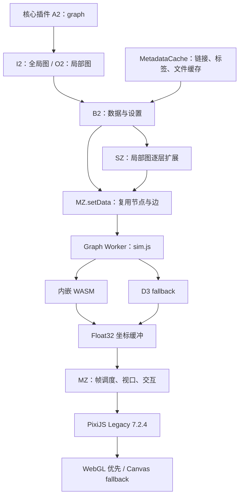

# Obsidian Graph View 实现方式

DonQ，本机 Obsidian 图谱的核心链路已还原：**MetadataCache 生成拓扑 → Graph 数据引擎筛选 → 独立 Worker 计算布局 → PixiJS 绘图**。布局优先用内嵌 WebAssembly，失败后才用 JavaScript D3 fallback。

分析日期：2026-10-26。对象是本机 `obsidian-1.14.4.asar`，包内版本为 **1.14.4**。Windows 卸载注册表记录的安装器版本为 **1.13.7**。两者应分开记录；本次未启动完整界面核对实际加载版本。

## 证据与范围

已实际调用本机 **REA 6.7.0 CLI**。本会话没有 REA MCP 工具，未修改 MCP 配置。REA 的静态分析选择了 `package.json`、`app.js`、`sim.js`、`index.html`，读取约 3.96 MB 文本，解析两个 JavaScript 文件，**解析失败数为 0**。

- 包路径：`C:\Users\donq\AppData\Roaming\obsidian\obsidian-1.14.4.asar`
- 包 SHA-256：`146ef8470d8cbb4a6db209bdc19bf2bad13350444186c0fd93c31087b142b92f`
- 主 REA Evidence：`ev_8a49fb2610921e48d06283cae404b312d4a975899fb22b467b8a34b97b71cef8`
- Worker trace Evidence：`ev_59a09e8274f8c2730f91e4691f9957daf0ab47de4e3e822edc95c501380ea1b4`

REA 的结构图为 partial，语义图为 partial/truncated。单文件语义节点上限为 20,000；另有 34 个相关清单文件未选作源码分析。Worker 的 outgoing trace 仅保留一个节点、零条边，**没有自动恢复完整图谱调用链**。以下细节由同一包的源码追踪和隔离执行补足，不能全部归因于 REA 自动输出。

另行检查了包内 `lib/pixi.min.js` 和 `app.css`。全部行为探针使用合成数据。没有读取笔记正文，也没有改动安装包或用户 Vault。

## 模块如何连接

下面的名字是本版本的压缩符号，不是稳定公共 API。



`A2` 注册 `graph:open`、`graph:open-local`、`graph:animate`，并注册 `graph` 与 `localgraph` 两种视图。两个视图复用 `MZ` renderer 和 `B2` 数据引擎。视图关闭时调用 renderer.destroy，再终止 Worker。

## 数据层：先有链接索引，再生成图

`B2.render()` 实际读取 `metadataCache.resolvedLinks`、`unresolvedLinks`、缓存文件列表和标签信息。它没有在每次绘图时重新扫描 Markdown 正文。

生成的数据形状可概括为：

```js
{
  nodes: {
    "A.md": { type: "", links: { "B.md": true } },
    "B.md": { type: "", links: {} }
  },
  weights: undefined // 局部图可提供单独的显示权重
}
```

- `resolvedLinks` 中的次数会被压成布尔边。同一文件写九次 `[[B]]`，图层仍只有一条 A→B 边。
- 标签、附件和未创建目标可以成为不同类型的节点。筛选开关决定是否生成它们。
- 隐藏孤立笔记时，代码检查图中的有效入边与出边，并排除自环的贡献。
- 搜索和 Groups 复用内部搜索解析器。搜索可筛选节点；Groups 按顺序选择匹配颜色。分组首先改变颜色，不会直接生成“分组聚合力”。
- 全局视图监听 MetadataCache 的 `resolved`；数据引擎还监听相关文件、解析、主题和当前文件事件。搜索输入有 250 ms 延迟合并。

**局部图**由 `SZ()` 从 `localFile` 逐层扩展。可分别启用前向链接、反向链接及邻居间连线。中心显示权重为 30；深度为 D 时，第 k 层权重为 `30 - 30*k/D`。这组权重传给 renderer 决定节点大小；Worker 消息没有包含它们，不能当成布局质量或吸引力。

官方公共 API 也定义了 source→destination→count 结构，可作独立实现的数据入口。[MetadataCache 类型定义](https://github.com/obsidianmd/obsidian-api/blob/9abd9605ce081383674aae1ed111c456edde0688/obsidian.d.ts#L6495-L6533)

## 布局层：Worker + WASM，D3 作回退

`MZ` 创建名为 **Graph Worker** 的 Worker，入口为 `/sim.js`。主线程发送节点集合、边列表和控制参数；Worker 返回坐标。

```js
// 新增节点用 [x,y]；已有节点用 false 保留当前布局状态。
{ nodes: { "A.md": false, "B.md": [100, 40] },
  links: [["A.md", "B.md"]], alpha: 0.3, run: true }

// 拖动时固定节点，并维持模拟温度。
{ forceNode: { id: "A.md", x: 80, y: 50 },
  alpha: 0.3, alphaTarget: 0.3, run: true }

// 松开后解除固定，恢复冷却。
{ forceNode: { id: "A.md", x: null, y: null }, alphaTarget: 0 }
```

WASM 以 Base64 内嵌在 `sim.js` 中，解码后为 **3,322 字节**，无须另行下载。它导出 `init`、`simulate`、`complete`、`manyBody`、`visitCharge`、`visitCollide` 等函数。节点记录为 20 字节，含 x/y/vx/vy/degree；边记录为 12 字节，含两个节点索引和 bias。每 tick 从 WASM 读取位置与速度，再应用固定坐标。

源码与隔离执行支持这些设置：

| 项目 | 实现细节 |
|---|---|
| 中心力 | 默认 0.1，分别将 x/y 拉向原点 |
| 链接力 | 默认强度 1、距离 250；按端点 degree 修正强度与位移分配 |
| 排斥力 | 默认内部值 -1000 |
| 阻尼 | 每 tick 速度乘 0.6 |
| 冷却 | `alpha += (target-alpha)*(1-0.001^(1/300))` |
| 调度 | `setTimeout(1000/60)`；alpha≤0.001 后停止 |

这是调度目标，不能当作实测 60 FPS。隔离探针在默认条件下得到 300 帧输出，然后停止。

WASM 初始化失败时，代码打印 `Using fallback d3 simulator`，改用内联 JavaScript 力模拟。该回退包含四叉树排斥近似、theta=0.9、最小排斥距离 30，以及半径 60、强度 0.5 的碰撞力。尚未确认它的精确 D3 版本，也未完整反编译 WASM 的空间索引。因此不能把回退路径的全部常数直接套在 WASM 上。

**滑块并非线性映射。** Center 与 Link 的归一值 u 使用 `(0.01^(1-u)-0.01)/0.99`；Repel 使用 `u³`，再在 Worker 中取负；Link distance 直接传值，范围 30–500。

**此包的回退差异：** fallback 中刷新力对象的门控变量始终为 false。隔离探针改变四项 forces 后，连续八帧坐标与默认设置完全相同；WASM 则会改变结果。这是本文件的可复现行为，尚未在完整 UI 中强制触发该回退。

## 绘图层：PixiJS 场景对象与手动帧循环

本包附带 **pixi.js-legacy 7.2.4**。`MZ.initGraphics()` 创建 `PIXI.Application`，设置 `autoStart:false`，由自己的 requestAnimationFrame 回调调用 `render()`。库中 WebGL renderer 的优先级高于 Canvas renderer；因此这份实现不能简化成“只支持 WebGL”。

- 节点 `kZ` 使用 `PIXI.Graphics` 画圆，用 `PIXI.Text` 显示名称。
- 连线 `CZ` 使用容器、矩形线段和箭头图形，根据端点位置计算长度与角度；互为反向的边会合并显示重叠线段。
- 全局图的显示权重是入边数加出边数。双向关系会计两次。节点半径为 `nodeSizeMultiplier * clamp(3*sqrt(weight+1), 8, 30)`。
- 高亮、关联节点淡入、文字透明度和缩放独立于布局计算。悬停节点及其直接邻居保持突出。
- 颜色通过临时 `.graph-view.color-*` DOM 元素的 `getComputedStyle()` 取得，再转给 Pixi 对象。因此 CSS 主题可以控制图谱颜色。

Worker 返回 `{id, buffer}`，坐标按 `[x0,y0,x1,y1,...]` 以 float32 排列。普通 ArrayBuffer 使用 transfer list；支持 SharedArrayBuffer 时复用坐标内存，并在末尾加一个 Uint32 版本。主线程据此读取新坐标。SAB 路径未使用 Atomics；本次没有验证真实跨线程竞争。

**交互**也在 renderer 中处理：滚轮缩放、鼠标拖动平移、惯性、触控缩放、键盘移动和节点拖动。节点坐标通过图容器的局部变换换算。单击普通节点调用 `workspace.openLinkText()`；单击标签启动标签搜索；悬停可触发 Obsidian 的 `hover-link`。

## 为什么它能保持流畅

这里列出源码中可确认的措施，不把它们当作性能基准：

1. 物理计算放在 Worker 中；WASM 用连续内存处理状态。
2. `setData()` 对比已有节点和边，复用对象与坐标。仅颜色改变不会重建布局；拓扑不变也不会重新向 Worker 发送图。
3. 每帧最多初始化 50 个尚未创建的节点图形，先处理靠近视口中心的节点。
4. 对节点、文字和边做视口可见性判断，并渐变透明度。
5. 布局冷却后停止；renderer 在空闲计数超过 60 时停止排新帧，收到变化再唤醒。

活动帧仍会遍历节点和边。视口判断不代表完全跳过所有不可见对象；本次也没有测量万节点图的帧率或内存。

## 复现时可以采用的最小结构

这是根据证据提出的实现方案，没有在本次另建一个图谱产品：

1. 维护文件节点表和有向布尔边，解析层负责链接解析、未创建目标与标签。
2. 用纯数据步骤生成全局图或指定深度的局部图；单独计算显示权重。
3. 独立 Worker 维护位置、速度与固定坐标；用 D3-force 即可先完成可用版本。
4. 以 TypedArray 传坐标，用 Pixi 场景显示圆点、边和标签，另管相机与命中交互。
5. 复用节点状态，加上冷却、渐进初始化和视口判断。只有性能数据需要时，再加入 WASM。

## 验证结果与复查位置

已通过两组隔离探针：

- `app.js`：链接次数去重、未解析目标开关、孤立节点、标签大小写、局部深度及权重、邻居连线、双向度数、节点复用、无变化时不重启、节点删除、半径公式。
- `sim.js`：两条引擎路径、固定及释放节点、无效边过滤、冷却、定时器去重、WASM 内存布局与参数应用、SAB 布局，以及普通 buffer 的 transfer list。

探针执行的是发布包里的实际函数，但使用模拟依赖、合成数据和有界假定时器。它们没有验证完整 UI、真实浏览器消息转移、GPU 后端选择、SAB 竞争或大型 Vault 性能。

下列偏移均为**原始文件的 0 基 UTF-8 字节偏移**，范围右端不包含。压缩名只适用于本包。

| 文件 | 位置 | 字节范围 |
|---|---|---:|
| app.js | A2，插件入口 | 2726992–2729509 |
| app.js | B2.render，图数据 | 2737929–2740181 |
| app.js | SZ，局部图 | 2406650–2407446 |
| app.js | MZ.setData，增量更新 | 2402215–2404242 |
| app.js | MZ.initGraphics，绘图与帧循环 | 2395051–2400936 |
| app.js | kZ.getSize，节点半径 | 2389039–2389157 |
| app.js | j2 等，力滑块 | 2752751–2754195 |
| sim.js | 输入处理 | 5329 起 |
| sim.js | WASM 加载与选择 | 6200 起 |
| sim.js | WASM 调用 | 11419 起 |
| sim.js | D3 fallback 门控 | 16738 起 |
| sim.js | 输出 buffer 与调度 | 17167 起 |

[精简证据索引](evidence-summary.json)保留文件哈希、精确跨度、REA 原始限制及 Worker 观察。[完整证据包](rea-obsidian-evidence.zip)包含原始 REA JSON、trace、验证脚本、验证结果和更细的 Worker 分析；不含 Obsidian 安装包。

REA 的 CLI 与 MCP 采用同一应用分析流程。[REA 官方说明](https://github.com/morluto/rea/blob/main/docs/cli.md) 官方 Graph View 帮助可核对功能与设置，但没有公开内部绘图和布局实现。[Obsidian 官方帮助](https://obsidian.md/help/plugins/graph)
